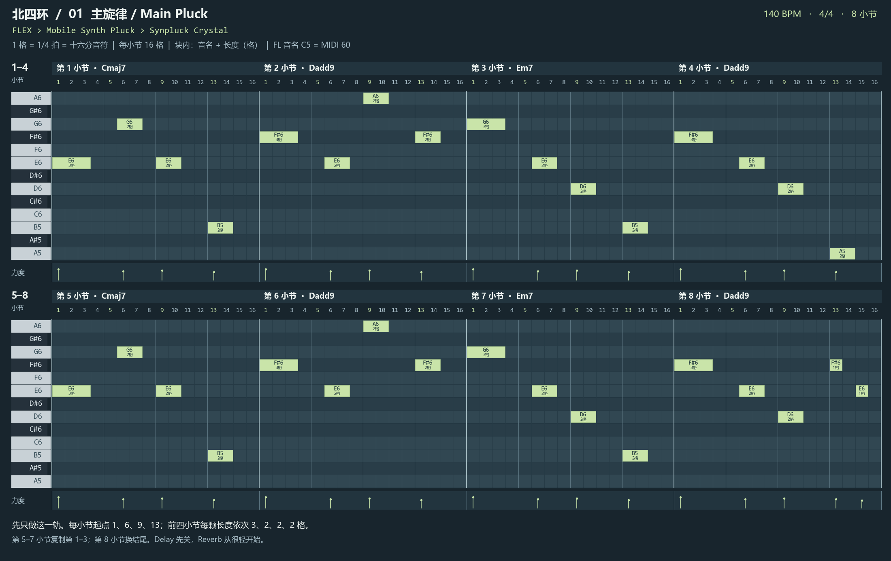
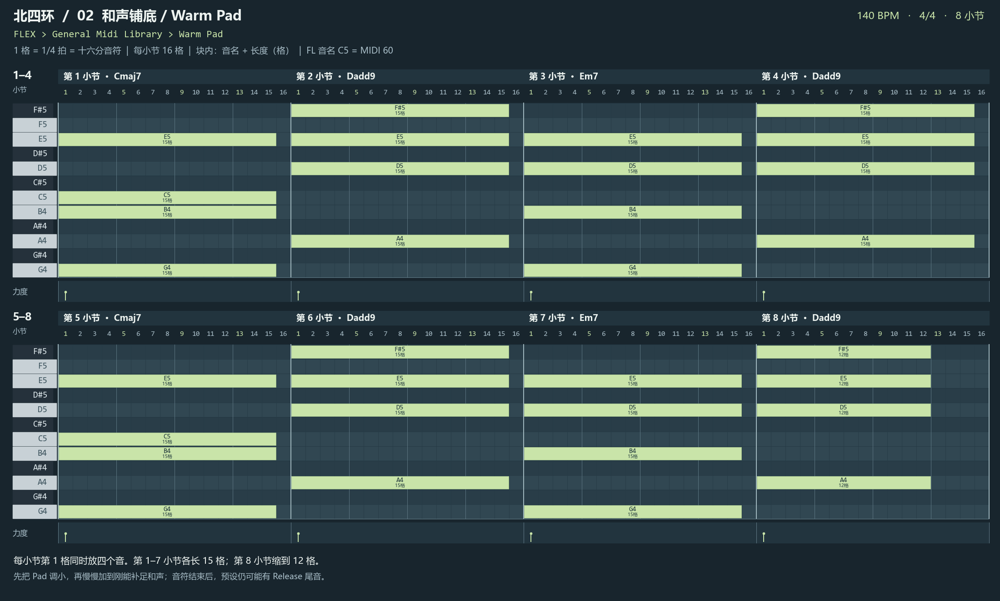
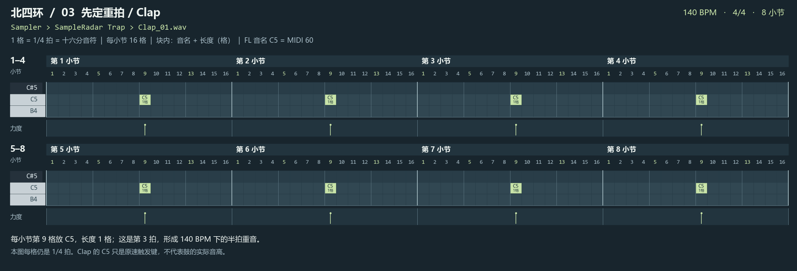
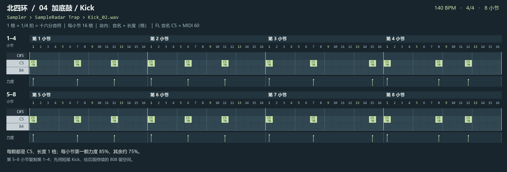
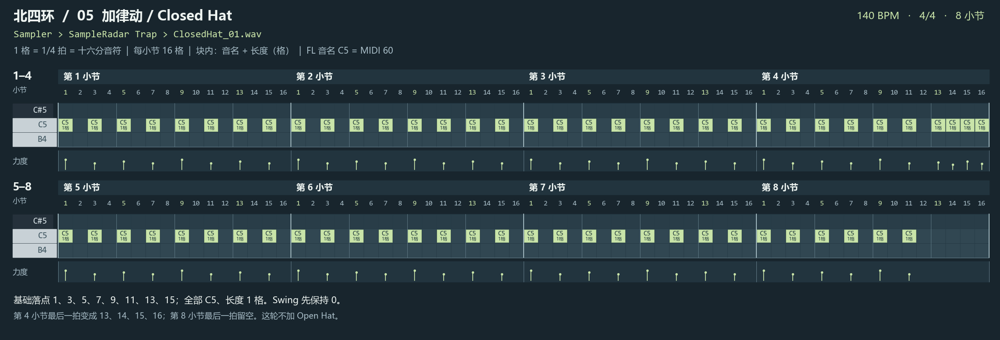
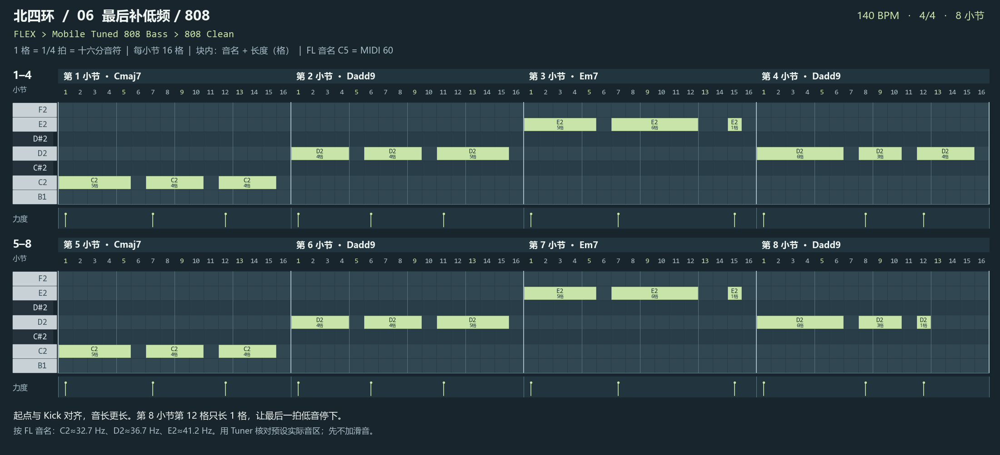

# 《北四环》：140 BPM，照图输入的 8 小节 Loop

这版沿用原创音符草案，用明亮 Pluck、轻 Pad、半拍 Clap 与持续 808 作为参考方向。没有截取《保利中心》的旋律或音频；不是原曲扒谱。参考音色方向来自此前本地分析，未确认原曲具体预设。本版未在你的 FL 音源上试听。

## 先统一网格

1. 工程设为 **140 BPM、4/4**，新建 Pattern `北四环_Loop_140`。
2. Piano Roll 的磁铁 Snap 选择 **1/4 beat**。把视图放大到每小节能数清 16 格；不要用会随缩放改变格距的 Line 来解释下图。
3. **1 格 = 1/4 拍 = 十六分音符；2 格 = 半拍；4 格 = 1 拍；16 格 = 1 小节。** 140 BPM 下一格约 0.1071 秒。
4. 每小节格数重新从 1 数到 16；第 1、5、9、13 格分别是第 1、2、3、4 拍的开始。
5. **起点在所列格的左边界。** 第 6 格、长 2 格，占第 6 和第 7 格，到第 8 格左边界结束。图中音块内上行是音高，下行是长度。空白不放音。
6. 音名按 **FL Studio：C5 = MIDI 60**；`F#` 是升 F。横轴上层是小节，下面的 1–16 是格数。上下两行接起来是完整 8 小节。
7. 每个音色独立建 Channel，先全部写在同一个 8 小节 Pattern；完整循环从第 1 小节左边界到第 9 小节左边界，约 **13.71 秒**。

官方说明：[Piano Roll 网格与编辑](https://www.image-line.com/fl-studio-learning/fl-studio-online-manual/html/pianoroll.htm)、[FL 的 C5 / MIDI 60 说明](https://www.image-line.com/fl-studio-learning/fl-studio-online-manual/html/plugins/Transistor%20Bass.htm)。

## 六层顺序

| 顺序 | Channel | 具体音色 |
|---|---|---|
| 1 | Main Pluck | FLEX > Mobile Synth Pluck > Synpluck Crystal |
| 2 | Warm Pad | FLEX > General Midi Library > Warm Pad |
| 3 | Clap | Sampler > SampleRadar Trap > Clap_01.wav |
| 4 | Kick | Sampler > SampleRadar Trap > Kick_02.wav |
| 5 | Closed Hat | Sampler > SampleRadar Trap > ClosedHat_01.wav |
| 6 | 808 | FLEX > Mobile Tuned 808 Bass > 808 Clean |

先完成主旋律，再加 Pad；之后按 Clap → Kick → Closed Hat → 808 做。暂不加 Flute、Open Hat 或额外主旋律。

## 01  主旋律 / Main Pluck

选择 **FLEX > Mobile Synth Pluck > Synpluck Crystal**，Channel 命名为 `Main Pluck`。

在 Channel Rack 添加一个 FLEX，选择上面的包，再点击对应预设。

先只做这一轨。每小节起点 1、6、9、13；前四小节每颗长度依次 3、2、2、2 格。

| 小节 | 按图放音：起始格 → 音高 × 长度 |
|---|---|
| 1 | 1 → E6 × 3 格；6 → G6 × 2 格；9 → E6 × 2 格；13 → B5 × 2 格 |
| 2 | 1 → F#6 × 3 格；6 → E6 × 2 格；9 → A6 × 2 格；13 → F#6 × 2 格 |
| 3 | 1 → G6 × 3 格；6 → E6 × 2 格；9 → D6 × 2 格；13 → B5 × 2 格 |
| 4 | 1 → F#6 × 3 格；6 → E6 × 2 格；9 → D6 × 2 格；13 → A5 × 2 格 |
| 5 | 1 → E6 × 3 格；6 → G6 × 2 格；9 → E6 × 2 格；13 → B5 × 2 格 |
| 6 | 1 → F#6 × 3 格；6 → E6 × 2 格；9 → A6 × 2 格；13 → F#6 × 2 格 |
| 7 | 1 → G6 × 3 格；6 → E6 × 2 格；9 → D6 × 2 格；13 → B5 × 2 格 |
| 8 | 1 → F#6 × 3 格；6 → E6 × 2 格；9 → D6 × 2 格；13 → F#6 × 1 格；15 → E6 × 1 格 |

第 5–7 小节复制第 1–3；第 8 小节换结尾。Delay 先关，Reverb 从很轻开始。

第 1 小节示范：E6 从第 1 格开始、拉长 3 格；G6 从第 6 格开始、长 2 格；E6 从第 9 格开始、长 2 格；B5 从第 13 格开始、长 2 格。先把这一小节做对，再填写后面的。

每小节前四颗力度依次约 75%、60%、68%、55%。第 8 小节最后两颗分别 60%、52%。先听清每一颗起音；尾音盖住后面的音，再调短包络。

## 02  和声铺底 / Warm Pad

选择 **FLEX > General Midi Library > Warm Pad**，Channel 命名为 `Warm Pad`。

在 Channel Rack 添加一个 FLEX，选择上面的包，再点击对应预设。

每小节第 1 格同时放四个音。第 1–7 小节各长 15 格；第 8 小节缩到 12 格。

| 小节 | 按图放音：起始格 → 音高 × 长度 |
|---|---|
| 1 | 第 1 格：G4 + B4 + C5 + E5，同时开始，各长 15 格 |
| 2 | 第 1 格：A4 + D5 + E5 + F#5，同时开始，各长 15 格 |
| 3 | 第 1 格：G4 + B4 + D5 + E5，同时开始，各长 15 格 |
| 4 | 第 1 格：A4 + D5 + E5 + F#5，同时开始，各长 15 格 |
| 5 | 第 1 格：G4 + B4 + C5 + E5，同时开始，各长 15 格 |
| 6 | 第 1 格：A4 + D5 + E5 + F#5，同时开始，各长 15 格 |
| 7 | 第 1 格：G4 + B4 + D5 + E5，同时开始，各长 15 格 |
| 8 | 第 1 格：A4 + D5 + E5 + F#5，同时开始，各长 12 格 |

先把 Pad 调小，再慢慢加到刚能补足和声；音符结束后，预设仍可能有 Release 尾音。

每颗力度先用 50%。第 8 小节四颗音在第 13 格左边界松开；可听尾音还取决于 Release。

## 03  先定重拍 / Clap

选择 **Sampler > SampleRadar Trap > Clap_01.wav**，Channel 命名为 `Clap`。

把 `Clap_01.wav` 拖入 Channel Rack，成为单独的 Sampler Channel，再打开它的 Piano Roll。

每小节第 9 格放 C5，长度 1 格；这是第 3 拍，形成 140 BPM 下的半拍重音。

| 小节 | 按图放音：起始格 → 音高 × 长度 |
|---|---|
| 1 | 9 → C5 × 1 格 |
| 2 | 9 → C5 × 1 格 |
| 3 | 9 → C5 × 1 格 |
| 4 | 9 → C5 × 1 格 |
| 5 | 9 → C5 × 1 格 |
| 6 | 9 → C5 × 1 格 |
| 7 | 9 → C5 × 1 格 |
| 8 | 9 → C5 × 1 格 |

本图每格仍是 1/4 拍。Clap 的 C5 只是原速触发键，不代表鼓的实际音高。

力度约 80%。先只播放 Pluck + Pad + Clap，确认第 3 拍的重音稳。

## 04  加底鼓 / Kick

选择 **Sampler > SampleRadar Trap > Kick_02.wav**，Channel 命名为 `Kick`。

把 `Kick_02.wav` 拖入 Channel Rack，成为单独的 Sampler Channel，再打开它的 Piano Roll。

每颗都是 C5、长度 1 格；每小节第一颗力度 85%，其余约 75%。

| 小节 | 按图放音：起始格 → 音高 × 长度 |
|---|---|
| 1 | 1 → C5 × 1 格；7 → C5 × 1 格；12 → C5 × 1 格 |
| 2 | 1 → C5 × 1 格；6 → C5 × 1 格；11 → C5 × 1 格 |
| 3 | 1 → C5 × 1 格；7 → C5 × 1 格；15 → C5 × 1 格 |
| 4 | 1 → C5 × 1 格；8 → C5 × 1 格；12 → C5 × 1 格 |
| 5 | 1 → C5 × 1 格；7 → C5 × 1 格；12 → C5 × 1 格 |
| 6 | 1 → C5 × 1 格；6 → C5 × 1 格；11 → C5 × 1 格 |
| 7 | 1 → C5 × 1 格；7 → C5 × 1 格；15 → C5 × 1 格 |
| 8 | 1 → C5 × 1 格；8 → C5 × 1 格；12 → C5 × 1 格 |

第 5–8 小节复制第 1–4；先用短尾 Kick，给后面持续的 808 留空间。

## 05  加律动 / Closed Hat

选择 **Sampler > SampleRadar Trap > ClosedHat_01.wav**，Channel 命名为 `Closed Hat`。

把 `ClosedHat_01.wav` 拖入 Channel Rack，成为单独的 Sampler Channel，再打开它的 Piano Roll。

基础落点 1、3、5、7、9、11、13、15；全部 C5、长度 1 格。Swing 先保持 0。

| 小节 | 按图放音：起始格 → 音高 × 长度 |
|---|---|
| 1 | 1 → C5 × 1 格；3 → C5 × 1 格；5 → C5 × 1 格；7 → C5 × 1 格；9 → C5 × 1 格；11 → C5 × 1 格；13 → C5 × 1 格；15 → C5 × 1 格 |
| 2 | 1 → C5 × 1 格；3 → C5 × 1 格；5 → C5 × 1 格；7 → C5 × 1 格；9 → C5 × 1 格；11 → C5 × 1 格；13 → C5 × 1 格；15 → C5 × 1 格 |
| 3 | 1 → C5 × 1 格；3 → C5 × 1 格；5 → C5 × 1 格；7 → C5 × 1 格；9 → C5 × 1 格；11 → C5 × 1 格；13 → C5 × 1 格；15 → C5 × 1 格 |
| 4 | 1 → C5 × 1 格；3 → C5 × 1 格；5 → C5 × 1 格；7 → C5 × 1 格；9 → C5 × 1 格；11 → C5 × 1 格；13 → C5 × 1 格；14 → C5 × 1 格；15 → C5 × 1 格；16 → C5 × 1 格 |
| 5 | 1 → C5 × 1 格；3 → C5 × 1 格；5 → C5 × 1 格；7 → C5 × 1 格；9 → C5 × 1 格；11 → C5 × 1 格；13 → C5 × 1 格；15 → C5 × 1 格 |
| 6 | 1 → C5 × 1 格；3 → C5 × 1 格；5 → C5 × 1 格；7 → C5 × 1 格；9 → C5 × 1 格；11 → C5 × 1 格；13 → C5 × 1 格；15 → C5 × 1 格 |
| 7 | 1 → C5 × 1 格；3 → C5 × 1 格；5 → C5 × 1 格；7 → C5 × 1 格；9 → C5 × 1 格；11 → C5 × 1 格；13 → C5 × 1 格；15 → C5 × 1 格 |
| 8 | 1 → C5 × 1 格；3 → C5 × 1 格；5 → C5 × 1 格；7 → C5 × 1 格；9 → C5 × 1 格；11 → C5 × 1 格 |

第 4 小节最后一拍变成 13、14、15、16；第 8 小节最后一拍留空。这轮不加 Open Hat。

基础八颗力度依次 60%、38%、50%、40%、60%、38%、50%、40%；第 4 小节最后四颗为 45%、30%、50%、35%。

## 06  最后补低频 / 808

选择 **FLEX > Mobile Tuned 808 Bass > 808 Clean**，Channel 命名为 `808`。

在 Channel Rack 添加一个 FLEX，选择上面的包，再点击对应预设。

起点与 Kick 对齐，音长更长。第 8 小节第 12 格只长 1 格，让最后一拍低音停下。

| 小节 | 按图放音：起始格 → 音高 × 长度 |
|---|---|
| 1 | 1 → C2 × 5 格；7 → C2 × 4 格；12 → C2 × 4 格 |
| 2 | 1 → D2 × 4 格；6 → D2 × 4 格；11 → D2 × 5 格 |
| 3 | 1 → E2 × 5 格；7 → E2 × 6 格；15 → E2 × 1 格 |
| 4 | 1 → D2 × 6 格；8 → D2 × 3 格；12 → D2 × 4 格 |
| 5 | 1 → C2 × 5 格；7 → C2 × 4 格；12 → C2 × 4 格 |
| 6 | 1 → D2 × 4 格；6 → D2 × 4 格；11 → D2 × 5 格 |
| 7 | 1 → E2 × 5 格；7 → E2 × 6 格；15 → E2 × 1 格 |
| 8 | 1 → D2 × 6 格；8 → D2 × 3 格；12 → D2 × 1 格 |

按 FL 音名：C2≈32.7 Hz、D2≈36.7 Hz、E2≈41.2 Hz。用 Tuner 核对预设实际音区；先不加滑音。

力度先用 80%。用已有 FLEX 预设时，先保留它的调音映射；图中音长是 MIDI 按住的时长，实际持续与尾音由音源决定。遇到过低或音不准，先用调音器核对，不把其他软件的八度名套进来。

## 完成后的检查

- 单独播放主旋律，四小节内能记住形状；能分清每次起音。
- Pad 只补和声，主旋律依然靠前。
- Clap 固定在第 9 格；第 4 小节 Hat 结尾变密，第 8 小节最后一拍 Hat 与 808 停下。
- 第 8 小节走完仍保留完整空拍，再从第 1 小节接回。不要把循环边界截在最后一个音符尾端。
- 用自己的哼唱试四句，每两小节一句，先以每句 10–14 个发声音节做试唱预算；实际字数随拖音与停顿调整。

静态检查可以保证图和音符数据一致；是否贴合参考的听感，仍需用这些实际预设播放并与参考做相近音量对照。

页面保留可下载图谱，音符来自同一份原创数据。所有图片由同一份音符数据绘制，方便后续按实际听感改版。
